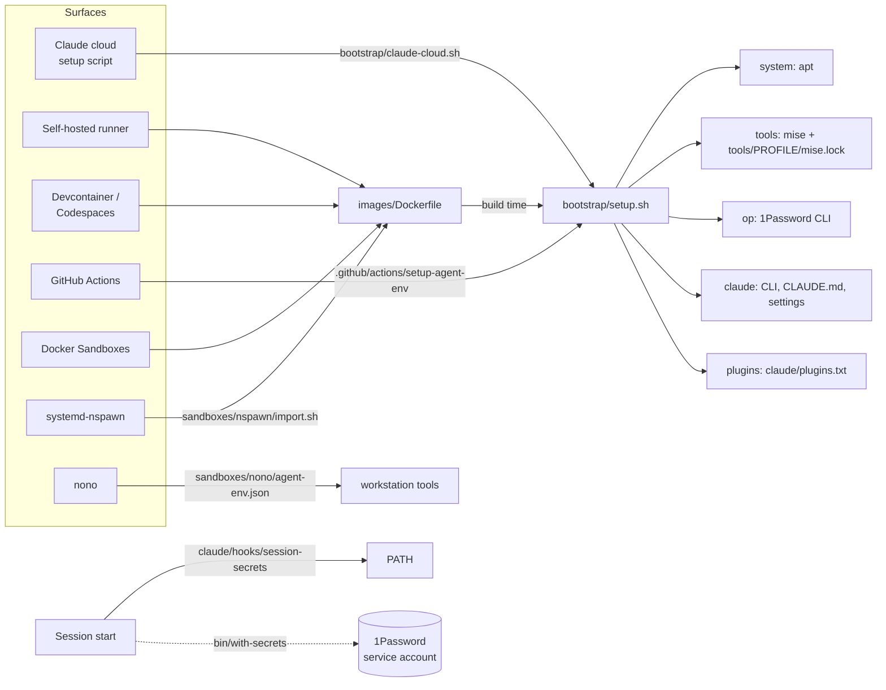

# agent-environments

One bootstrap for an agent toolchain on every surface Claude Code runs on:
Claude Code cloud environments, self-hosted runners, devcontainers and
Codespaces, GitHub Actions, Docker Sandboxes, systemd-nspawn, and `nono`.
Secrets come from 1Password.



## What gets installed

| Layer | Contents |
| --- | --- |
| system | `bubblewrap`, `socat`, `build-essential`, `jq`, `unzip`, `gnupg` (disposable machines only) |
| tools, core | bun, node, nushell, just, ripgrep, fd, sd, ast-grep, jq, yq, gh, oxlint, oxfmt, biome, rumdl, dprint, taplo, shellcheck, shfmt, prek, osv-scanner, gitleaks, socket, sfw, vlt, wrangler, cf |
| tools, full | core plus cloudflared, glab, jj, d2, lychee, actionlint, zizmor, pinact, hadolint, bats, cosign, syft, trivy, trufflehog, nono |
| op | 1Password CLI 2.41 or later, from the signed apt repo or a gpg-verified zip |
| claude | Claude Code, `claude/CLAUDE.md` as `~/.claude/CLAUDE.md`, `claude/settings.json` merged into user settings |
| plugins | `claude/plugins.txt` from the marketplaces in `claude/marketplaces.txt` |

Tool versions are locked in `tools/<profile>/mise.lock`, so a setup run
never asks GitHub what "latest" is. The npm CLIs are pinned in
`tools/core/mise.toml` to versions scored with `socket package shallow`.

On a workstation (`local`, `nono`), setup leaves system packages, global
mise config, and `~/.claude` alone. It only installs into the profile
directory and adds missing plugins.

## Surfaces

### Claude Code cloud environment

1. In claude.ai/code, open the environment's settings.
2. **Setup script**: paste `bootstrap/claude-cloud.sh`. It clones this repo
   to `/opt/agent-environments` and runs the core profile. A cold run takes
   about a minute. The result is cached.
3. **Environment variables**: start from `env/cloud-environment.env.example`.
4. **Network access**: Custom, with `env/cloud-network-allowlist.txt` and
   the default package-manager list.

Setup runs before the environment's variables exist, so no secret is
needed or used there. Secrets load at session time.

Repo settings don't install plugins in cloud sessions. The setup script
installs them into `/root/.claude` instead.

### GitHub Actions

```yaml
- uses: danielbodnar/agent-environments/.github/actions/setup-agent-env@main
  with:
    profile: core
    layers: system,tools,op
    op-env-file: .github/secrets.env.tpl   # optional
  env:
    OP_SERVICE_ACCOUNT_TOKEN: ${{ secrets.OP_SERVICE_ACCOUNT_TOKEN }}
```

`.github/workflows/claude.yml` runs `anthropics/claude-code-action@v1` as a
read-only reviewer on `@claude` comments.

- A PR checkout can be fork code, and issue text can carry a prompt
  injection. So that workflow runs nothing from the checkout: no setup
  step, no repo settings, no plugins.
- The agent gets Read, Glob, and Grep only, no shell, and no 1Password
  token.

Use the composite action, with its plugins and secrets, only in workflows
that run on trusted input.

### Container image

`images/Dockerfile` builds one image for the container surfaces. CI
publishes it to `ghcr.io/danielbodnar/agent-environments`.

- Ubuntu 24.04 and the full profile, running as `agent` (uid 1000).
  Claude Code refuses `--dangerously-skip-permissions` as root.
- Plugins are baked into `/opt/claude-seed` and read through
  `CLAUDE_CODE_PLUGIN_SEED_DIR`, so a volume over `~/.claude` doesn't hide
  them.
- `/etc/claude-code/managed-settings.json` sets
  `sandbox.enableWeakerNestedSandbox`, which the Bash sandbox needs inside
  an unprivileged container.

| Surface | How |
| --- | --- |
| Devcontainer, Codespaces | `.devcontainer/devcontainer.json` builds the image. Set `OP_SERVICE_ACCOUNT_TOKEN` and `CLAUDE_CODE_OAUTH_TOKEN` as Codespaces secrets. |
| Self-hosted runner | `self-hosted/claude-runner@.container` (quadlet) runs `claude self-hosted-runner` with `self-hosted/runner-wrapper.sh`. |
| Docker Sandboxes | `sbx run ./sandboxes/sbx/agent-env .` uses the workload kit in `sandboxes/sbx/agent-env/`. |
| systemd-nspawn | `just nspawn-import` exports the image to `/var/lib/machines/agent-env` (its own ZFS dataset when the parent is ZFS). |

### nono

```sh
sandboxes/nono/claude-nono            # same arguments as claude
```

The launcher runs `claude` under `sandboxes/nono/agent-env.json`, which
extends nono's `mise-dev` and `bun-dev` profiles.

- The session gets its own `CLAUDE_CONFIG_DIR` and `TMPDIR` under
  `~/.local/state/agent-environments/nono-claude`. It starts from copies of
  `~/.claude/settings.json`, `CLAUDE.md`, and the login.
- `~/.claude` and `~/.claude.json` aren't writable, so a sandboxed agent
  can't plant hooks, settings, or plugin code for later unsandboxed
  sessions.
- Installed plugins load read-only through `CLAUDE_CODE_PLUGIN_SEED_DIR`.
- The mise tools are read-only.
- Network is limited to Anthropic, GitHub, the package registries, Socket,
  OSV, Cloudflare, and 1Password.

### Claude Managed Agents

`managed-agents/environment.yaml` describes the npm half of the toolchain
for `ant apply`.

## Secrets

```sh
with-secrets -- wrangler deploy
with-secrets --env-file env/.env.tpl -- bun run deploy
with-secrets --check
```

`bin/with-secrets` wraps `op run`. It reads:

- **Auth**: `OP_SERVICE_ACCOUNT_TOKEN`, or `OP_CONNECT_HOST` and
  `OP_CONNECT_TOKEN` for a 1Password Connect server.
- **Sources**: `OP_ENVIRONMENT_ID` (a 1Password Environment), and env files
  of `op://` references such as `env/.env.tpl`.

Without auth, the command runs without secrets and prints a warning.

The SessionStart hook (`claude/hooks/session-secrets`) always puts the
toolchain on `PATH`. It exports secrets into the session only when
`AGENT_ENV_EXPORT_SECRETS=1`. The default keeps secret values inside
`with-secrets` calls.

A service account is the default. It needs no server and can read
Environments. Connect can't read Environments and has to be reachable from
every agent; see [connect/README.md](connect/README.md).

The [1Password plugin for Claude Code](https://www.1password.dev/environments/claude-plugin)
talks to the 1Password desktop app. So it's in `claude/plugins.local.txt`,
installed on workstations only. Turn on Settings > Developer >
"Integrate with MCP clients" in the desktop app to use it.

## Develop

```sh
just test    # bats suite
just lint    # shellcheck, shfmt, rumdl, actionlint, zizmor
just plan    # dry run of setup on this machine
just cloud-test
just image
```

Edit `claude/plugins.txt` or `claude/marketplaces.txt`, then run
`just settings` to regenerate `claude/settings.json`.
